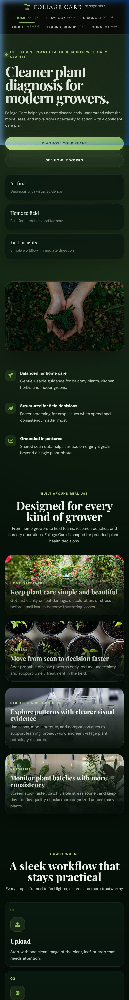
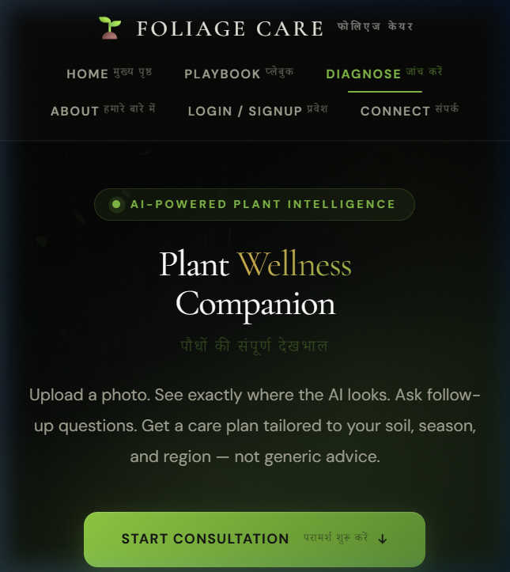
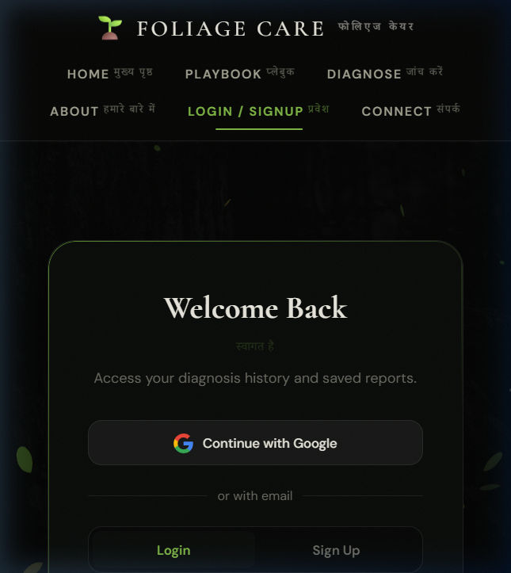
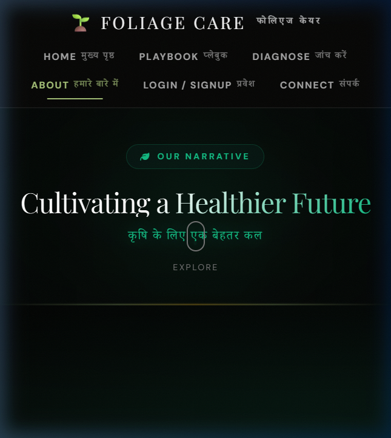
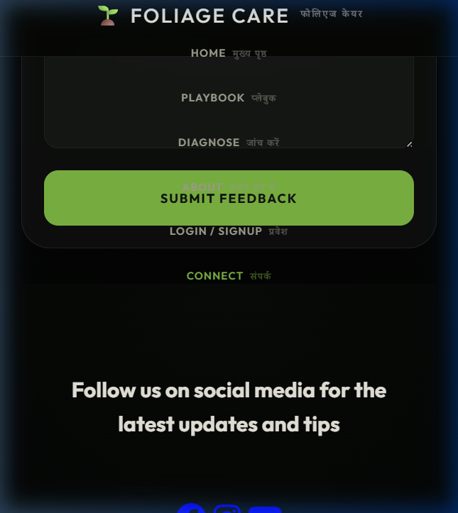
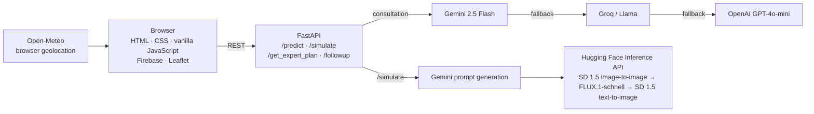

# Foliage Care

Foliage Care is an AI-assisted plant-health consultation web app. It combines a vanilla JavaScript frontend, a FastAPI backend, multimodal AI services, and Firebase to help users review plant symptoms, explore treatment options, and track scans over time.

> **Project demo:** [Watch the walkthrough](https://youtu.be/OYd5J8wdxEc)

## Features

- **Plant diagnosis:** Upload a plant image for a structured report with plant and disease names, severity, confidence, visual evidence, affected-region coordinates, and recommended next steps.
- **Treatment plans:** Request an image-aware, India-focused plan that starts with household and organic options before presenting chemical interventions as a last resort.
- **Progression simulation:** Generate an illustrative image of how a diagnosed condition might appear after seven untreated days.
- **Follow-up chat:** Ask questions grounded in the current diagnosis. The backend keeps a short conversation history and supports multilingual replies.
- **Personal plant tracking:** Firebase Authentication and Firestore support user profiles, plant records, scan history, and the My Garden dashboard.
- **Community map:** A Leaflet map can display location-based community scan reports stored in Firestore. Reports are submitted when the user has granted browser geolocation access.
- **Weather-aware context:** The frontend can request location access and retrieve current and recent weather data from Open-Meteo to inform consultation requests.
- **Role-adaptive advice:** Prompts can be tailored for farmers, nursery operators, home gardeners, and students/researchers.

AI-generated diagnoses and treatment suggestions are decision-support information, not a substitute for assessment by a qualified plant-health professional. Treat generated progression images as illustrations, not scientific forecasts. Follow local product labels and expert guidance for any pesticide use.

## Consultation workflow

Foliage Care organizes a plant-health consultation into four stages:

1. **Diagnose** — Analyze an uploaded plant image and return a structured report with visual evidence, confidence, and affected-region overlays.
2. **Simulate** — Optionally generate an illustrative image of how symptoms might look after seven untreated days. This is a visualization, not a reliable forecast.
3. **Prescribe** — Build a season- and context-aware treatment plan, prioritizing lower-impact options and reserving chemical products for last-resort consideration.
4. **Consult** — Continue with follow-up questions grounded in the diagnosis and recent conversation.

### India-focused treatment tiers

Treatment plans are framed as escalating options for Indian growing contexts:

| Tier | Approach | Examples / guidance |
|---|---|---|
| **1 — Immediate / household** | Contain spread and try practical household or desi remedies | Isolate affected plants, remove badly damaged leaves, or consider a carefully prepared neem-oil remedy where appropriate |
| **2 — Organic** | Consider organic products or biological controls | Examples include Jeevamrut, Panchagavya, or *Trichoderma viride*, depending on the plant and suspected issue |
| **3 — Chemical, last resort** | Consider an appropriate Indian-market product only if earlier steps do not help | Follow the product label, safety instructions, and personal protective equipment (PPE) requirements; seek expert guidance when uncertain |

Plans can also include seasonal prevention tips and a referral to a nearby Krishi Vigyan Kendra (KVK) for expert advice.

### Role-adaptive advice

| Persona | How the guidance is tailored |
|---|---|
| **Farmer** | Field- and acreage-aware actions, crop impact, Kharif/Rabi/Zaid context, and KVK guidance |
| **Nursery operator** | Batch management, plant segregation, propagation hygiene, and tool sanitation |
| **Home gardener** | Friendly, jargon-light advice for indoor, balcony, and terrace plants, with practical household options |
| **Student / researcher** | More technical terminology, differential-diagnosis reasoning, and pathogen context |

## Screenshots

| Landing page | Diagnosis page |
|---|---|
|  |  |

| Login page | About page | Contact page |
|---|---|---|
|  |  |  |

## Architecture



The backend can fall back from Gemini to Groq/Llama and OpenAI for consultation requests when those providers are configured. For illustrative progression images, it tries Stable Diffusion image-to-image first, then FLUX.1-schnell text-to-image, followed by Stable Diffusion text-to-image.

## API

Start the backend, then visit `http://localhost:8000/docs` for the interactive FastAPI documentation. `GET /` returns a service status and the configured engine readiness.

| Endpoint | Input | Purpose |
|---|---|---|
| `POST /predict` | `multipart/form-data` with `file`; optional user, location, weather, context, and `model_preference` fields | Plant diagnosis and structured visual evidence/action plan |
| `POST /simulate` | `multipart/form-data` with `file` and `disease_name`; optional context and location fields | Generate an illustrative progression image and return it as base64 |
| `POST /get_expert_plan` | `multipart/form-data` with `file` and `disease`; optional user, location, weather, and context fields | Generate a Markdown treatment plan |
| `POST /followup` | JSON with `question`, `disease`, and optional `conversation_history` and user/context fields | Ask a follow-up question about the active diagnosis |

For `/predict`, `/get_expert_plan`, and `/followup`, `model_preference` accepts `auto`, `gemini`, `groq`, or `openai`. In `auto` mode, configured engines are tried in sequence.

## Technology

- **Frontend:** HTML, CSS, vanilla JavaScript, Leaflet.js
- **Backend:** Python 3.11+, FastAPI, Uvicorn, Pillow
- **AI:** Google Gemini, Groq, OpenAI, Hugging Face Inference API
- **Data and auth:** Firebase Authentication and Cloud Firestore
- **Weather:** Open-Meteo API
- **Deployment support:** Docker, Google Cloud Run, Render

## Project layout

```text
Foliage_Care/
├── Backend/
│   ├── main.py                  # FastAPI app and API endpoints
│   ├── models/                  # Model-related Python code
│   ├── utils/                   # AI prompts, weather, image and Grad-CAM utilities
│   ├── tests/                   # Backend tests and utilities
│   ├── class_indices.json
│   └── foliagecare_model.keras  # Local model artifact, if used
├── Frontend/
│   ├── index.html               # Landing page
│   ├── start.html               # Diagnosis and consultation interface
│   ├── profile.html             # Profile and scan history
│   ├── dashboard_cinematic_3.html
│   ├── map.html                 # Community map
│   ├── playbook.html             # Plant-care playbook
│   ├── login.html
│   ├── assets/screenshots/
│   ├── css/
│   └── js/
├── graphify-out/                # Generated standalone knowledge graph output
├── Dockerfile
├── render.yaml
├── requirements.txt             # Python dependencies
└── README.md
```

`graphify-out/graph.html` is a generated, standalone visualization artifact. It is not integrated into the main app's navigation or consultation workflow.

## Run locally

### Requirements

- Python 3.11 or newer
- A Google Gemini API key for the primary AI engine
- A Hugging Face token for progression-image generation
- Optional: OpenAI and Groq API keys for fallback engines
- A Firebase project for authentication and Firestore-backed features

### 1. Install backend dependencies

From the repository root:

```bash
python -m venv .venv
```

Activate the virtual environment:

```powershell
# Windows PowerShell
.venv\Scripts\Activate.ps1
```

```bash
# macOS / Linux
source .venv/bin/activate
```

Then install dependencies:

```bash
pip install -r requirements.txt
```

### 2. Configure backend keys

Create `Backend/.env` with the keys you intend to use:

```env
GEMINI_API_KEY=your_gemini_api_key
HF_TOKEN=your_huggingface_token
OPEN_API_KEY=your_openai_api_key
GROQ_API_KEY=your_groq_api_key
```

`GEMINI_API_KEY` enables the primary model. `OPEN_API_KEY` and `GROQ_API_KEY` configure fallback providers; `HF_TOKEN` is used for image generation. Keep secret keys out of source control. The backend reads `OPEN_API_KEY` (with this exact spelling).

### 3. Start the backend

From the repository root:

```bash
cd Backend
uvicorn main:app --reload --host 0.0.0.0 --port 8000
```

The API is available at `http://localhost:8000`, with interactive docs at `http://localhost:8000/docs`.

### 4. Serve the frontend

In a separate terminal, from the repository root:

```bash
python -m http.server 5500 --directory Frontend
```

Open `http://localhost:5500` in your browser. Serving the files over HTTP supports the frontend's JavaScript modules and browser APIs.

**Local API note:** `Frontend/js/up.js` currently sends consultation requests to the deployed Cloud Run service (`https://foliage-care-775030113450.asia-south1.run.app`). To use the local backend, change those API URLs to `http://localhost:8000` while developing locally.

### Firebase setup

The frontend initializes Firebase in `Frontend/js/firebase.js`. For a separate Firebase project, update its web-app configuration there, enable the sign-in providers used by the app, and configure Firestore and its security rules in the Firebase console.

## Deployment

The repository includes a `Dockerfile` for container deployment and a `render.yaml` for Render. Configure the required API secrets in the deployment environment (`GEMINI_API_KEY`, `HF_TOKEN`, `OPEN_API_KEY`, and, if used, `GROQ_API_KEY`). The container uses the platform-provided `PORT` when available.

## License

No license is currently specified in this repository. Add a `LICENSE` file to define reuse and redistribution terms.
